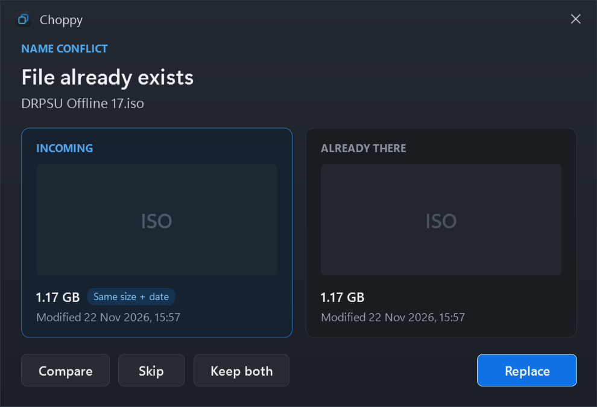

# Choppy

> **📋⚡ Windows 10 / 11 - fast, clear file copier ⚡ everything that matters in one plain, dark window.**

[](https://github.com/1nstntKaRma/Choppy/releases/latest)

-512BD4)


**Choppy** copies and moves files fast and shows everything that matters in one dark window: from where to where, how far it is, the live and the average speed, the time so far and the time left, the file in flight and what takes the space. It can take over **Ctrl+V** in Explorer, or stay on the right-click menu only.

It never leaves a half-written file behind, a move removes the original only after the copy is checked, a copy cut off by a crash or a power cut can be resumed, and a folder that needs administrator rights (`C:\`, `Program Files`) gets them with one question.

<p align="center">
  
  &nbsp;
  
</p>

---

## Highlights

- **Fast where it counts:** big files between local drives are read and written at the same time - large pieces, several reads queued at the disk, past the Windows cache - so a busy disk (a torrent client, an indexer) doesn't slow it down. Small files and network shares go through Windows' own copy engine (`CopyFileEx`), many at once. *Adaptive* picks per copy.
- **Clear:** a compact view (from / to, progress, sizes, times, current file) and an extended view (speed graph, current file, largest files, quick toggles, queue). Color code: blue = speed right now, lavender = average, green = done, peach = total, amber = time.
- **Never loses a file:** each file is written under a temporary name and gets its real name only when it is complete (and checked, when verify is on). Cancel, skip or a crash leaves nothing half-written.
- **Zero dependencies:** one `Choppy.exe` (~280 KB) on **.NET Framework 4.8**, part of every Windows 10/11. Installs per user - no administrator rights.

---

## Download & Quick Start

### Option 1: PowerShell One-Liner

Paste and run in PowerShell (works on any stock Windows 10/11 PC - no `git` needed). It downloads into a temporary folder, builds (or takes the ready-made exe when there's no .NET SDK), asks what to do, and cleans up:

```powershell
$ProgressPreference='SilentlyContinue'; $d="$env:TEMP\Choppy"; $z="$d.zip"; Remove-Item $d,$z -Recurse -Force -EA 0; try { [Net.ServicePointManager]::SecurityProtocol=[Net.SecurityProtocolType]::Tls12; Invoke-WebRequest https://github.com/1nstntKaRma/Choppy/archive/refs/heads/main.zip -OutFile $z -UseBasicParsing; Expand-Archive $z $d -Force; Set-ExecutionPolicy Bypass -Scope Process -Force; & "$d\Choppy-main\build.ps1" } finally { Remove-Item $d,$z -Recurse -Force -EA 0 }
```

`build.ps1` asks (`Choice:`):

| Choice | Result |
|---|---|
| **`[1] Install + Default file manager`** | Installs Choppy; **Ctrl+V** of copied or cut files in Explorer (and on the desktop) opens Choppy. It waits in the tray and starts with Windows (default). |
| **`[2] Install - right-click only`** | Installs Choppy; Windows' own copy stays the default. Use right-click **Paste with Choppy**. |
| **`[3] Remove Choppy`** | Removes everything `build.ps1` added. |
| **`[4] Cancel`** | Exits without changing anything. |

Non-interactive: `-Shell Apply`, `-Shell RightClick`, `-Shell Install` (keeps the user's choices, opens the settings), `-Shell Revert`, `-Shell Cancel` (build only), plus `-NoBuild`.

### Option 2: Download Pre-Built Release

1. Download **`Choppy-v<version>.zip`** from the **[latest release](https://github.com/1nstntKaRma/Choppy/releases/latest)** and extract it.
2. Double-click **`Activate Choppy.cmd`** (install + Default file manager).
3. To remove it at any time, double-click **`Revert to Windows Copy.cmd`**.

> **Windows SmartScreen:** the exe isn't signed with a commercial certificate, so Windows may show *"Windows protected your PC"* on first run (*More info* -> *Run anyway*).

> **Verify your download:** releases are built by GitHub Actions from the tagged source, list SHA-256 checksums (`SHA256SUMS.txt`, also checked by `build.ps1` when it downloads the exe) and carry build provenance: `gh attestation verify Choppy-v<version>.zip --repo 1nstntKaRma/Choppy`.

---

## Default File Manager

**On:** Ctrl+V of files in an Explorer window or on the desktop is handed to Choppy (a small keyboard hook in Choppy itself - nothing is loaded into Explorer). Ctrl+V while renaming a file, in the address bar or in search stays a normal paste; virtual places like *This PC* keep Explorer's own paste. Drag and drop stays Windows' own copy.

**Off:** Windows is left alone. Choppy works through right-click **Paste with Choppy** on folders, folder backgrounds and drives.

Only one copier may own Ctrl+V: while it's on, another copier that takes Ctrl+V is closed and its startup entry is set aside; turning it off puts the entry back.

Switch it in Choppy's settings or from its tray icon.

---

## The Window

- **Compact** (default) or **Extended** - Choppy remembers your choice.
- **From / To:** the drive's name and the folder on both sides, so a copy within one drive is as clear as one between two.
- **Quick toggles** (extended view): **Close at completion**, **Verify files** and **Speed limit** (with its value, in the unit on screen) - green dot = on, red = off. They are the same switches as in Settings and work on the copy that is running.
- **File already there:** *Incoming* vs *Already there* with previews, sizes and dates - **Compare** (same content?), **Skip**, **Keep both**, **Replace**, and *Apply to all*.
- **Queue:** a new copy waits while one runs; finished copies stay in the list with their report.
- **End report:** copied / verified / skipped / failed, average speed, **Retry failed**, **Log**, **Open folder**. *Close at completion* closes the window a few seconds after a clean finish; a copy with problems stays open.

<p align="center">
  
  &nbsp;
  
</p>

## Folders That Need Administrator Rights

Choppy runs as you, never as administrator (its Ctrl+V hook and clipboard live in your session). When a destination only lets administrators add files - `C:\`, `C:\Program Files`, `C:\Windows` - Choppy asks once per copy: *This folder needs administrator rights. Copy as administrator?*

- **Yes:** the rest of that copy goes to a short-lived Choppy started as administrator, in its own window; it does just that copy and exits. Your window follows it (progress, Pause, Cancel) and its numbers join your report. Files copied before the question stay done.
- **No:** those files are listed as failed, like before - **Retry failed** asks again.

The administrator copy keeps every rule: temporary names, verify before a move removes the original, nothing half-written on cancel, a job record and a log. It never installs the keyboard hook and never touches the startup entry or the right-click menu.

---

## Adaptive Engine

| Situation | What Choppy does |
|---|---|
| Move on the same drive | Renames in place - instant, nothing is copied |
| NAS / network share / VPN | 8-16 files in flight for many small files (measures and goes up to 32 when that is faster), big files one at a time with Windows' pipelined writes |
| SSD / NVMe | 4-8 files in flight; big files through the pipeline (8 MB pieces) |
| Hard disk / USB stick | One stream, in order - no seeking; big files through the pipeline (32 MB pieces, 4 reads queued at the disk) |

**The pipeline** (big files between local drives): one thread reads, one writes, at the same time; the next pieces are already queued at the source disk, so another program reading that disk can't send its heads away between them. With verify on (or for a move) the source is hashed on the way in, so the check reads only the copy back. Extra data streams (`Zone.Identifier` of downloads), dates and attributes come along. The badge shows the choice: *Adaptive · 1 stream*.

## Never Loses A File

- Written as `<name>.chpart`, renamed into place when complete - a half file never has the real name.
- **Verify** (xxHash64) reads each copy back and compares; a move always checks before it removes the original.
- A job record stays on disk until a copy ends: after a crash or power cut the next start offers **Resume** - files already there with the same size and date are kept, only the rest is copied.
- Network dropped: it waits (up to 15 min) and goes on. File in use: tried again, then listed for **Retry failed**. Destination full: it pauses.
- Created and modified dates, read-only / hidden attributes and paths longer than 260 characters are kept.

## Measured

On one setup (Windows 10, NAS over Tailscale, ~9 ms, ~100 Mbps upload):

| | Result |
|---|---|
| Big files to the NAS | median **95.5 Mbps** |
| 600 small files to the NAS | **52 files/s** (32 in flight; 30 files/s with 8) |
| Local SSD, 2,027 files / 650 MB | **1.0 s** (3.4 s with every file verified) |

---

## What It Changes On The PC

Everything is per user:

- `%LOCALAPPDATA%\Programs\Choppy\Choppy.exe` + a Start menu shortcut
- `HKCU\Software\Choppy` (settings) and `%LOCALAPPDATA%\Choppy` (job records, logs)
- `HKCU\Software\Classes\{Directory, Directory\Background, Drive}\shell\ChoppyPaste` (right-click entry)
- Default file manager only: `HKCU\...\Run\Choppy` (tray at sign-in); another copier's `Run` value that Choppy set aside is kept in its settings and put back when it's turned off

`Revert to Windows Copy.cmd` / `build.ps1 -Shell Revert` removes all of it (logs stay).

## Command Line

```text
Choppy.exe copy <source...> <destination folder>
Choppy.exe move <source...> <destination folder>
Choppy.exe paste <destination folder>          (the files on the clipboard; cut = move)
Choppy.exe                                     settings
Choppy.exe --selftest <out.txt>                built-in checks
Choppy.exe --cli copy|move <source...> <destination folder> [--verify] [--json result.json]   headless (tests)
```

## Build From Source

Needs the .NET SDK (6 or newer) for WPF; the result runs on the built-in .NET Framework 4.8:

```powershell
.\build.ps1 -Shell Cancel      # -> bin\Choppy.exe + self-test
```

## License

[MIT](LICENSE) - by 1nstntKaRma. *Settings -> About* shows the version and the license.
