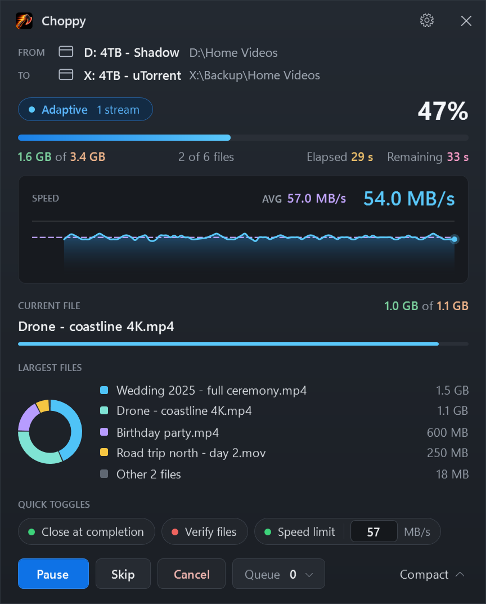
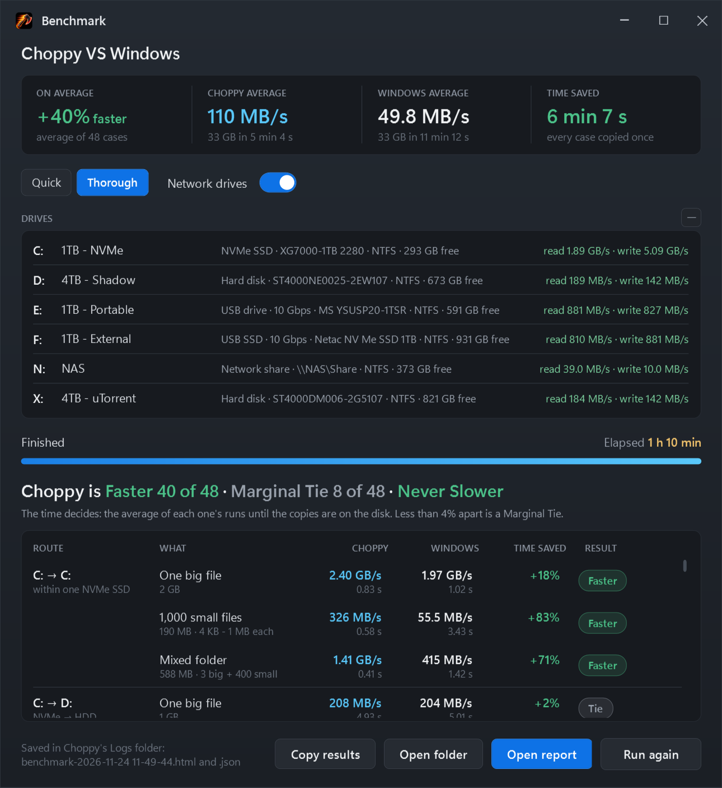

# Choppy

> **📋⚡ Windows 10 / 11 - fast, clear file copier ⚡ everything that matters in one plain, dark window.**

[](https://github.com/1nstntKaRma/Choppy/releases/latest)


**Choppy** copies and moves files and shows everything that matters in one dark window: from where to where, how far along it is, the speed now and on average, the time elapsed and remaining, and the file in flight. It can take over **Ctrl+V** in Explorer, or stay on the right-click menu only.

<p align="center">
  <picture></picture>
</p>

<p align="center">
  <picture></picture>
</p>

---

## Highlights

- **Adaptive transfer:** Choppy picks how to copy by the drives at both ends. Big files between local drives are read and written at the same time, in large pieces, with the next reads already queued at the disk, so another program using that disk (a torrent client, an indexer) gets in the way less. Many small files go several at once. A move within one drive is a rename.
- **Everything in one window:** a compact view, or an extended one with a speed graph, the current file, the largest files, quick toggles and the queue. One color per number: blue = speed right now, lavender = average, green = done, peach = total, amber = time elapsed, pink = time remaining.
- **Careful with your files:** each file is written under a temporary name and gets its real name once complete (and checked, with Verify on). A move deletes the original only after its copy is on the disk. After a cancel, a crash or a power cut, the next start offers **Resume**.
- **Quick:** with Choppy in the tray, its window opens in a fraction of a second after Ctrl+V or a right-click paste.
- **Checks your drives:** the drive's name on both sides of every copy, and a USB drive held back by its port, cable or hub is flagged beside its name (*⚠ USB 2.0, can do 5 Gbps*).
- **Built-in Benchmark:** *Settings → Benchmark* runs Choppy VS Windows on every drive and saves a report with both times per route.
- **Zero dependencies:** one `Choppy.exe` (about 3.7 MB) with everything inside - nothing else to install. Installs per user - no administrator rights.

---

## Download & Quick Start

### Option 1: PowerShell One-Liner

Paste and run in PowerShell (any stock Windows 10/11 PC, no `git` needed):

```powershell
$ProgressPreference='SilentlyContinue'; $d="$env:TEMP\Choppy"; $z="$d.zip"; Remove-Item $d,$z -Recurse -Force -EA 0; try { [Net.ServicePointManager]::SecurityProtocol=[Net.SecurityProtocolType]::Tls12; Invoke-WebRequest https://github.com/1nstntKaRma/Choppy/archive/refs/heads/main.zip -OutFile $z -UseBasicParsing; Expand-Archive $z $d -Force; Set-ExecutionPolicy Bypass -Scope Process -Force; & "$d\Choppy-main\build.ps1" } finally { Remove-Item $d,$z -Recurse -Force -EA 0 }
```

| Choice | Result |
|---|---|
| **`[1] Install + Default file manager`** | Ctrl+V of files in Explorer opens Choppy (default). |
| **`[2] Install - right-click only`** | Windows' copy stays the default; use right-click **Paste with Choppy**. |
| **`[3] Remove Choppy`** | Removes everything it added. |
| **`[4] Cancel`** | Changes nothing. |

Non-interactive: `-Shell Apply`, `-Shell RightClick`, `-Shell Revert` or `-Shell Cancel`.

### Option 2: Download Pre-Built Release

1. Download **`Choppy-v<version>.zip`** from the **[latest release](https://github.com/1nstntKaRma/Choppy/releases/latest)** and extract it.
2. Double-click **`Activate Choppy.cmd`**. To remove it, double-click **`Revert to Windows Copy.cmd`**.

> **Windows SmartScreen:** the exe isn't signed with a commercial certificate, so Windows may show *"Windows protected your PC"* on first run (*More info* -> *Run anyway*). Releases are built by GitHub Actions and list SHA-256 checksums (`SHA256SUMS.txt`).

---

## Choppy VS Windows

*Settings → Benchmark* times Choppy against Windows' own copy engine - the one Explorer uses - on every drive of your PC: one big file and many small files (plus a mixed folder in *Thorough*), from the system drive to each drive, back, and within each. Both copy the same files, take turns, and are timed until the copies are on the disk. Less than 4% apart is a **Marginal Tie**. The report is saved in `%LOCALAPPDATA%\Choppy\Logs`.

## The Window

- **Compact** or **Extended** - Choppy remembers your choice.
- **Quick toggles** (extended view): **Close at completion**, **Verify files** and **Speed limit**, for the copy that is running.
- **File already there:** both files side by side - **Compare**, **Skip**, **Keep both** or **Replace**, with *Apply to all*. Or set one answer for every copy in Settings.
- **Queue and end report:** a new copy waits while one runs; at the end, **Retry failed**, **Log** and **Open folder**.

## Default File Manager

**On:** Ctrl+V of files in an Explorer window or on the desktop opens Choppy. Pasting text (renaming a file, the address bar, search) and drag and drop stay Windows' own.

**Off:** Windows is left alone - use right-click **Paste with Choppy** on folders and drives.

Switch it in Settings or from the tray icon. If Choppy in the tray ever closes without being quit, it starts itself again once it is fully closed - a Choppy that is only busy is left alone.

## Adaptive Engine

| Situation | What Choppy does |
|---|---|
| Move within one drive | Renames in place - nothing is copied |
| SSD / NVMe | Several files at once; big files read and written at the same time |
| Hard disk / USB stick | One file at a time, in order; big files in large pieces with reads queued ahead |
| Both ends on one hard disk | Big files read in large blocks, then written, so the heads don't run back and forth |
| One SSD in a USB case | One stream with little in flight, so the case keeps up |
| Network share / NAS | Many small files in flight, big files one at a time |

The badge in the window shows the choice: *Adaptive · 1 stream*.

## Careful With Your Files

- Each file is written as `<name>.chpart` and renamed when complete.
- A move deletes an original only after its copy is flushed to the disk - and with **Verify** (xxHash64) on, only after the copy matches.
- **Resume:** after a crash or a power cut, the next start offers to finish the copy; files already there are kept.
- A dropped network is waited for, a file in use is tried again, a full destination pauses the copy. What still fails is listed for **Retry failed**.
- Dates, attributes and paths longer than 260 characters are kept.

## What It Changes On The PC

Everything is per user:

- `%LOCALAPPDATA%\Programs\Choppy\Choppy.exe` + a Start menu shortcut
- `HKCU\Software\Choppy` (settings) and `%LOCALAPPDATA%\Choppy` (logs, Benchmark reports)
- `HKCU\Software\Classes\{Directory, Directory\Background, Drive}\shell\ChoppyPaste` (right-click entry)
- Default file manager only: `HKCU\...\Run\Choppy` (tray at sign-in)

`Revert to Windows Copy.cmd` removes all of it (logs stay).

## License

[MIT](LICENSE) - by 1nstntKaRma. No telemetry, no update checks: the link in *About* opens your browser only when you click it.
