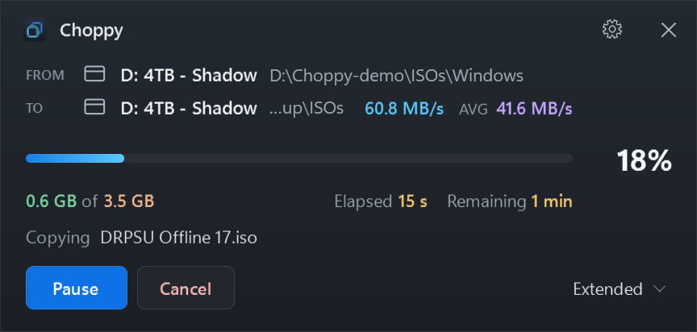
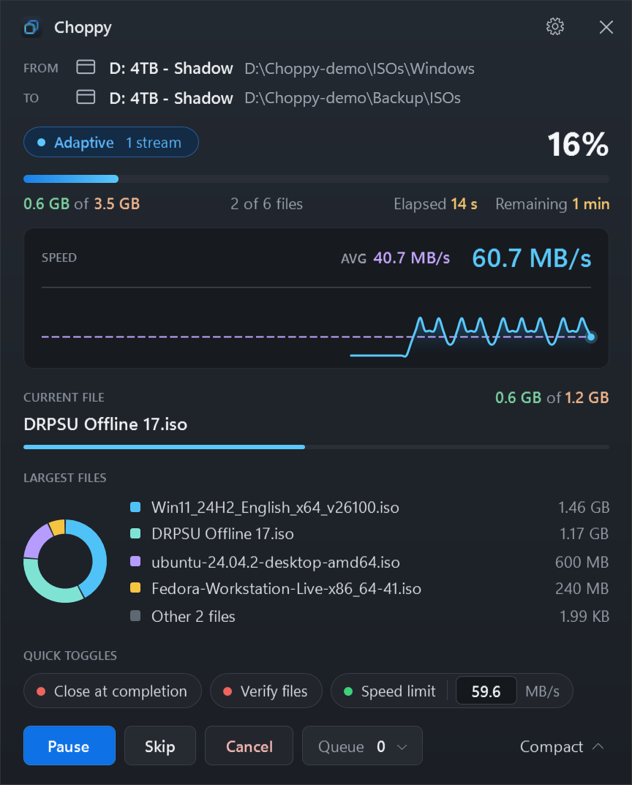
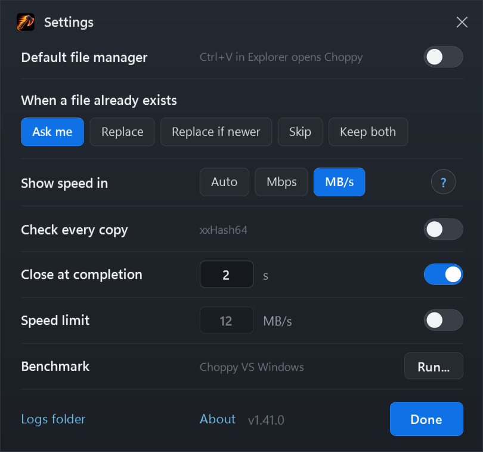
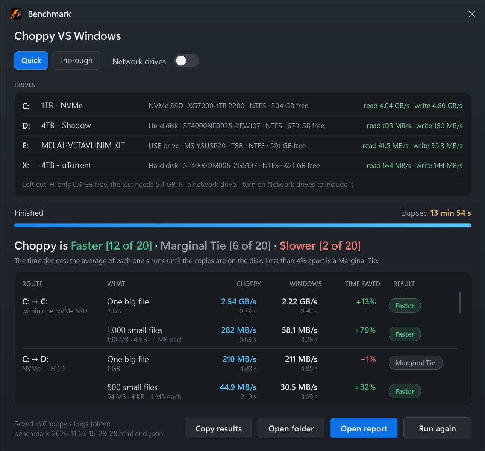

# Choppy

> **📋⚡ Windows 10 / 11 - fast, clear file copier ⚡ everything that matters in one plain, dark window.**

[](https://github.com/1nstntKaRma/Choppy/releases/latest)

-512BD4)


**Choppy** copies and moves files fast and shows everything that matters in one dark window: from where to where, how far it is, the live and the average speed, the time so far and the time left, the file in flight and what takes the space. It can take over **Ctrl+V** in Explorer, or stay on the right-click menu only.

It never leaves a half-written file behind, a move removes the original only after its copy is complete (and checked, with Verify on), a copy cut off by a crash or a power cut can be resumed, and a folder that needs administrator rights (`C:\`, `Program Files`) gets them with one question.

<p align="center">
  
  &nbsp;
  
</p>

---

## Highlights

- **Fast where it counts:** big files between local drives are read and written at the same time - large pieces, several reads queued at the disk, past the Windows cache - so a busy disk (a torrent client, an indexer) doesn't slow it down. Small files and network shares go through Windows' own copy engine (`CopyFileEx`), many at once. *Adaptive* picks per copy.
- **Clear:** a compact view (from / to, progress, sizes, times, current file) and an extended view (speed graph, current file, largest files, quick toggles, queue). Color code: blue = speed right now, lavender = average, green = done, peach = total, amber = time.
- **Never loses a file:** each file is written under a temporary name and gets its real name only when it is complete (and checked, when verify is on). Cancel, skip or a crash leaves nothing half-written.
- **Quick:** with Choppy in the tray, its window is up 0.1-0.2 s after Ctrl+V or a right-click paste - the first copy after it starts too.
- **Measured on your PC:** *Settings → Benchmark* runs Choppy VS Windows on every drive of the PC and saves a report with both times per route.
- **Zero dependencies:** one `Choppy.exe` (under 1 MB) on **.NET Framework 4.8**, part of every Windows 10/11. Installs per user - no administrator rights.

---

## Download & Quick Start

### Option 1: PowerShell One-Liner

Paste and run in PowerShell (works on any stock Windows 10/11 PC - no `git` needed). It downloads into a temporary folder, builds (or takes the ready-made exe when there's no .NET SDK), asks what to do, and cleans up:

```powershell
$ProgressPreference='SilentlyContinue'; $d="$env:TEMP\Choppy"; $z="$d.zip"; Remove-Item $d,$z -Recurse -Force -EA 0; try { [Net.ServicePointManager]::SecurityProtocol=[Net.SecurityProtocolType]::Tls12; Invoke-WebRequest https://github.com/1nstntKaRma/Choppy/archive/refs/heads/main.zip -OutFile $z -UseBasicParsing; Expand-Archive $z $d -Force; Set-ExecutionPolicy Bypass -Scope Process -Force; & "$d\Choppy-main\build.ps1" } finally { Remove-Item $d,$z -Recurse -Force -EA 0 }
```

`build.ps1` asks (`Choice:`):

| Choice | Result |
|---|---|
| **`[1] Install + Default file manager`** | Installs Choppy; **Ctrl+V** of copied or cut files in Explorer (and on the desktop) opens Choppy. It waits in the tray and starts with Windows (default). |
| **`[2] Install - right-click only`** | Installs Choppy; Windows' own copy stays the default. Use right-click **Paste with Choppy**. |
| **`[3] Remove Choppy`** | Removes everything `build.ps1` added. |
| **`[4] Cancel`** | Exits without changing anything. |

Non-interactive: `-Shell Apply`, `-Shell RightClick`, `-Shell Install` (keeps the user's choices, opens the settings), `-Shell Revert`, `-Shell Cancel` (build only), plus `-NoBuild`. Exit code 0 = done.

Started as administrator (an elevated prompt, or a tool that runs as administrator), `build.ps1` still installs for the person signed in to that desktop: a one-time task in their session, with their normal rights - on battery too - and the exit code is that step's own. A step that fails says why in `%TEMP%\Choppy-setup.log`.

### Option 2: Download Pre-Built Release

1. Download **`Choppy-v<version>.zip`** from the **[latest release](https://github.com/1nstntKaRma/Choppy/releases/latest)** and extract it.
2. Double-click **`Activate Choppy.cmd`** (install + Default file manager).
3. To remove it at any time, double-click **`Revert to Windows Copy.cmd`**.

> **Windows SmartScreen:** the exe isn't signed with a commercial certificate, so Windows may show *"Windows protected your PC"* on first run (*More info* -> *Run anyway*).

> **Verify your download:** releases are built by GitHub Actions from the tagged source, list SHA-256 checksums (`SHA256SUMS.txt`, also checked by `build.ps1` when it downloads the exe) and carry build provenance: `gh attestation verify Choppy-v<version>.zip --repo 1nstntKaRma/Choppy`.

---

## Default File Manager

**On:** Ctrl+V of files in an Explorer window or on the desktop is handed to Choppy (a small keyboard hook in Choppy itself - nothing is loaded into Explorer). So is Shift+Insert, the paste a clipboard manager sends. Ctrl+V while renaming a file, in the address bar or in search stays a normal paste; places that aren't folders - *This PC*, a library, a zip folder - keep Explorer's own paste. Drag and drop stays Windows' own copy.

The hook runs on a thread of its own and is put in again every few seconds, so a busy moment never hands a paste to Windows. Any start of Choppy (a right-click paste, the settings) brings it back to the tray, and a Choppy that closes on an error starts again. Each paste of files in Explorer is noted in `%LOCALAPPDATA%\Choppy\Logs\ctrl-v.txt`, with how quick the window was, or the reason whenever Windows did it instead.

The first window a program builds is slow (Windows and WPF set up their controls, fonts and drawing then - about a second). The tray copy builds one off-screen a few seconds after it starts and closes it again, so the first copy's window is as quick as every later one.

**Off:** Windows is left alone. Choppy works through right-click **Paste with Choppy** on folders, folder backgrounds and drives.

Only one copier may own Ctrl+V: while it's on, another copier that takes Ctrl+V is closed and its startup entry is set aside; turning it off puts the entry back.

Switch it in Choppy's settings or from its tray icon.

---

## The Window

- **Compact** (default) or **Extended** - Choppy remembers your choice.
- **From / To:** the drive's name and the folder on both sides, so a copy within one drive is as clear as one between two.
- **Quick toggles** (extended view): **Close at completion**, **Verify files** and **Speed limit** (with its value, in the unit on screen) - green dot = on, red = off. They are the same switches as in Settings and work on the copy that is running.
- **File already there:** *Incoming* vs *Already there* with previews, sizes and dates - **Compare** (same content?), **Skip**, **Keep both**, **Replace**, and *Apply to all*.
- **Queue:** a new copy waits while one runs; finished copies stay in the list with their report.
- **End report:** copied / verified / skipped / failed, average speed, **Retry failed**, **Log**, **Open folder**. *Close at completion* closes the window 2 seconds after a clean finish (the seconds are set in Settings, next to the switch); a copy with problems stays open.

<p align="center">
  
  &nbsp;
  
</p>

## Folders That Need Administrator Rights

Choppy runs as you, never as administrator (its Ctrl+V hook and clipboard live in your session). When a destination only lets administrators add files - `C:\`, `C:\Program Files`, `C:\Windows` - Choppy asks once per copy: *This folder needs administrator rights. Copy as administrator?*

- **Yes:** the rest of that copy goes to a short-lived Choppy started as administrator, in its own window; it does just that copy and exits. Your window follows it (progress, Pause, Cancel) and its numbers join your report. Files copied before the question stay done.
- **No:** those files are listed as failed, like before - **Retry failed** asks again.

The administrator copy keeps every rule: temporary names, verify (when on) before a move removes the original, nothing half-written on cancel, a job record and a log. It never installs the keyboard hook and never touches the startup entry or the right-click menu.

---

## Adaptive Engine

| Situation | What Choppy does |
|---|---|
| Move on the same drive | Renames in place - instant, nothing is copied |
| NAS / network share / VPN | 8-16 files in flight for many small files (measures and goes up to 32 when that is faster), big files one at a time with Windows' pipelined writes |
| SSD / NVMe | 4-8 files in flight; big files through the pipeline (8 MB pieces) |
| Hard disk / USB stick | One stream, in order - no seeking; big files through the pipeline (32 MB pieces, 8 reads queued at the disk; writes to a hard disk joined up to 128 MB) |
| To a hard disk, the last file fits in memory | Through the Windows cache in 4 MB writes, its size reserved first - as Explorer's copy does: done once it is in memory, Windows writes it out right after (never to a USB drive, never for a move or with Verify) |
| Two hard disks | Big files: 512 MB read ahead in 2 MB reads (4 at the disk at once), written in 64 MB pieces; once the source is fully read, what's left goes through the Windows cache |
| Both ends on one hard disk | Big files: the whole file (up to 512 MB at a time) read in 1 MB reads, then written in 64 MB writes into room reserved up front - not both at once, so the heads don't run back and forth |
| Copy within one ReFS drive (a Dev Drive) | Windows' own copy, which shares the original's blocks instead of writing them again (Windows 11 24H2 and later) |

**The pipeline** (big files between local drives): one thread reads, one writes, at the same time; the next pieces are already queued at the source disk, so another program reading that disk can't send its heads away between them. With verify on, the source is hashed on the way in, so the check reads only the copy back. Extra data streams (`Zone.Identifier` of downloads), dates and attributes come along. The badge shows the choice: *Adaptive · 1 stream*.

## Never Loses A File

- Written as `<name>.chpart`, renamed into place when complete - a half file never has the real name.
- **Moves:** an original is deleted only once its copy is on the disk itself - flushed, not just in memory - so a power cut right after can't lose both. Small files are flushed in batches, many at once. An original that changed while it was being moved is kept.
- **Verify** (xxHash64) reads each copy back and compares; with it on, a move removes the original only after its copy matches. The check proves the drive returns the same bytes.
- A job record stays on disk until a copy ends: after a crash or power cut the next start offers **Resume** - files already there with the same size and date are kept, only the rest is copied. Resuming a move checks each such copy's content before its original goes.
- Network dropped: it waits (up to 15 min) and goes on. File in use: tried again, then listed for **Retry failed**. Destination full: it pauses. A drive that refuses a file although it has room (a size limit) fails that file and goes on.
- A file of 4 GB or more for a **FAT32** drive (USB sticks, cards) is listed as failed at once, with the reason, instead of after 4 GB were written; the rest are copied.
- The PC doesn't go to sleep in the middle of a copy (the screen may still turn off); a paused copy lets it.
- Created and modified dates, read-only / hidden attributes and paths longer than 260 characters are kept.
- A file that only looks like Choppy's (`<name>.chpart` already there) is never touched: another temporary name is used.

## Benchmark

*Settings → Benchmark → Run...* runs **Choppy VS Windows** - Windows being its own copy engine, the one Explorer uses for a paste - on every drive of the PC it runs on, and shows which one takes less time where.

<p align="center">
  
</p>

- **Every drive, found by itself:** NVMe, SSD, hard disk, USB; mapped network drives on request. A drive that can't be tested is listed with the reason - read-only, a cloud drive (Google Drive and the like show up as a drive but aren't a disk of this PC), not enough free space.
- **Routes:** from the system drive to each other drive and back, and within each drive (on a hard disk, both ends then share one set of heads).
- **Cases:** one big file and many small files (4 KB-1 MB). The sizes go by each route's speed and stay the same on one PC, so runs of different versions compare: 2 GB and 1,000 files at 350 MB/s or more, 1 GB and 500 files below that, 512 MB and 250 files under 40 MB/s. *Thorough* doubles them, adds a mixed folder and a third round.
- **Fair:** both copy the same source, which is never in memory - it is read once beforehand (a new file's first open is slower) and dropped from the Windows cache before every copy. They take turns (Choppy, Windows, Windows, Choppy, the next case the other way round), each timed until its copies are on the disk (flushed).
- **The time decides:** the average of each one's runs. *Time saved* shows how much less time Choppy took (green) or more (red); less than 4% apart is a **Marginal Tie**, anything more is **Faster** or **Slower**. The summary reads *Choppy is Faster [12 of 20] · Marginal Tie [6 of 20] · Slower [2 of 20]* - and adds *Never Slower* when a whole run ends with none slower.
- **Leaves nothing behind:** test files go only into a `Choppy Benchmark (temporary)` folder on each drive, removed at the end - after *Stop* too - or at Choppy's next start if it was closed in the middle. Nothing else on the drives is touched.
- **Report:** every route and case with both average speeds and times, the time saved and the verdict, and the PC: CPU, memory, Windows build, each drive's model, bus and file system. Saved as `%LOCALAPPDATA%\Choppy\Logs\benchmark-<date>.html` plus a `.json` with every run's raw times, to compare PCs and versions; *Copy results* puts a short table on the clipboard.

**On this PC** (Ryzen 5 5600X, 16 GB, Windows 10 22H2; v1.41, *Quick*, 13 min 54 s): Choppy is Faster [12 of 20] · Marginal Tie [6 of 20] · Slower [2 of 20]. Average time until the copies are on the disk, Choppy / Windows (time saved):

| Route | One big file | Small files |
|---|---|---|
| Within the NVMe SSD (2 GB / 1,000 files) | 0.79 / 0.90 s (+13%) | 0.68 / 3.28 s (+79%) |
| NVMe → hard disk (1 GB / 500 files) | 4.88 / 4.85 s (−1%) | 2.10 / 3.09 s (+32%) |
| Hard disk → NVMe | 5.87 / 5.61 s (−5%) | 2.05 / 5.86 s (+65%) |
| Within one hard disk | 10.5 / 11.0 s (+4%) | 3.13 / 7.55 s (+58%) |
| NVMe → USB drive (here on a 40 MB/s port: 512 MB / 250 files) | 14.4 / 14.5 s (+1%) | 1.83 / 2.49 s (+26%) |
| USB drive → NVMe (1 GB / 500 files) | 24.6 / 24.7 s (0%) | 2.94 / 4.06 s (+28%) |

The second hard disk gave the same picture: small files +35% to +66%, big files −4% to +3%. The two *Slower* were hard disk → NVMe: Choppy then tried slower ways of reading the disk on every copy; without those trials (as released) it measured −3% and −1% over three runs each - Marginal Ties.

## Measured

On one setup (Windows 10, NAS over Tailscale, ~9 ms, ~100 Mbps upload):

| | Result |
|---|---|
| Big files to the NAS | median **95.5 Mbps** |
| 600 small files to the NAS | **52 files/s** (32 in flight; 30 files/s with 8) |
| Local SSD, 2,027 files / 650 MB | **1.0 s** (3.4 s with every file verified) |
| 10,000 files of 4 KB-1 MB (5 GB), NVMe to NVMe | **4.9-6.9 s** |
| One big file, NVMe to NVMe (4 GB) | **2.4 GB/s** |
| One big file, NVMe to hard disk (4 GB) | **~200 MB/s** |
| One big file, hard disk to another hard disk (4 GB) | **172-182 MB/s** on disk |
| One big file within one hard disk (4 GB) | **95-102 MB/s** (the disk streams ~180: every byte is read and written by the same heads) |
| 1,000 small files, hard disk to hard disk / within one hard disk | **90-93 / 67-69 MB/s** |
| Move of 2,000 files (1 GB), NVMe to hard disk, every copy on the disk before its original goes | **10.9-11.1 s** |
| Move of 400 small files to the NAS, same | **12.8-13.1 s** |
| Window on screen after a right-click paste, Choppy in the tray (the first copy after it starts too) | **0.14-0.20 s** |
| Window on screen when Choppy wasn't running | **~1.1 s** |

---

## What It Changes On The PC

Everything is per user:

- `%LOCALAPPDATA%\Programs\Choppy\Choppy.exe` + a Start menu shortcut
- `HKCU\Software\Choppy` (settings) and `%LOCALAPPDATA%\Choppy` (job records, logs)
- `HKCU\Software\Classes\{Directory, Directory\Background, Drive}\shell\ChoppyPaste` (right-click entry)
- Default file manager only: `HKCU\...\Run\Choppy` (tray at sign-in); another copier's `Run` value that Choppy set aside is kept in its settings and put back when it's turned off

`Revert to Windows Copy.cmd` / `build.ps1 -Shell Revert` removes all of it (logs stay).

## Command Line

```text
Choppy.exe copy <source...> <destination folder>
Choppy.exe move <source...> <destination folder>
Choppy.exe paste <destination folder>          (the files on the clipboard; cut = move)
Choppy.exe                                     settings
Choppy.exe --selftest <out.txt>                built-in checks
Choppy.exe --cli copy|move <source...> <destination folder> [--verify] [--json result.json]   headless (tests)
Choppy.exe --benchmark [out.json] [--thorough] [--network] [--drives C,D]     the benchmark, headless: out.json + out.html
```

`--benchmark` without a path saves into Choppy's Logs folder; `--list` only lists the drives and how long it would take. Exit code 0 = done, 3 = stopped (`--cancel-after <seconds>`), 1 = error.

## Build From Source

Needs the .NET SDK (6 or newer) for WPF; the result runs on the built-in .NET Framework 4.8:

```powershell
.\build.ps1 -Shell Cancel      # -> bin\Choppy.exe + self-test
```

## License

[MIT](LICENSE) - by 1nstntKaRma. *Settings -> About* shows the version and the license.
